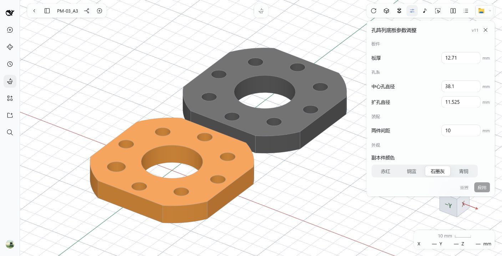
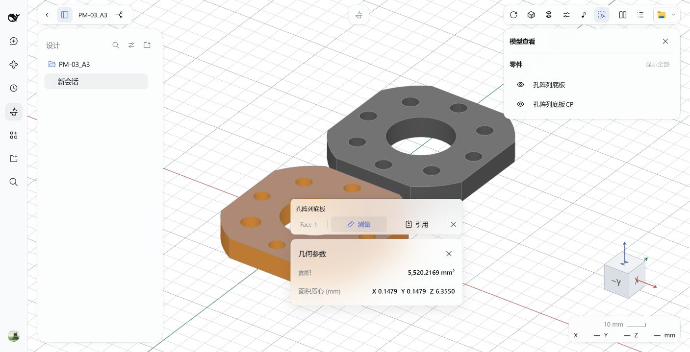
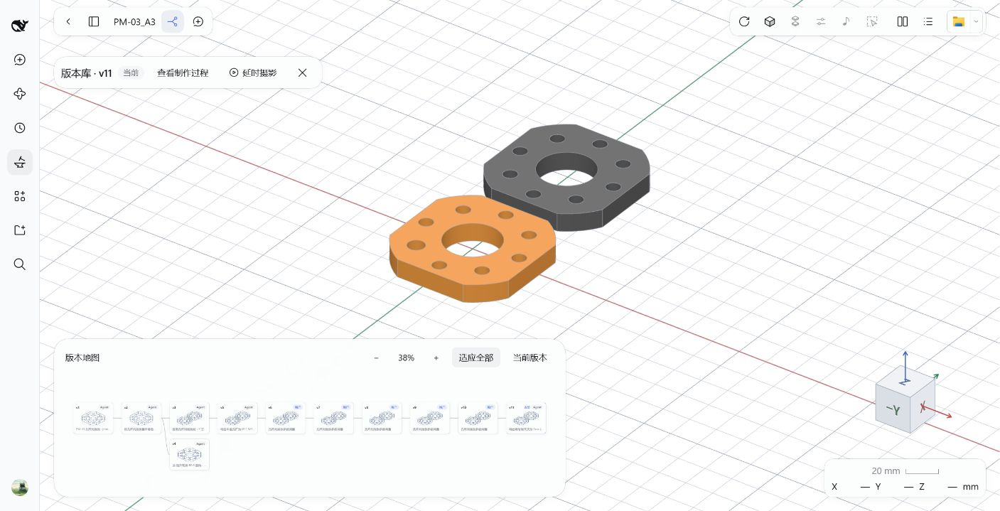
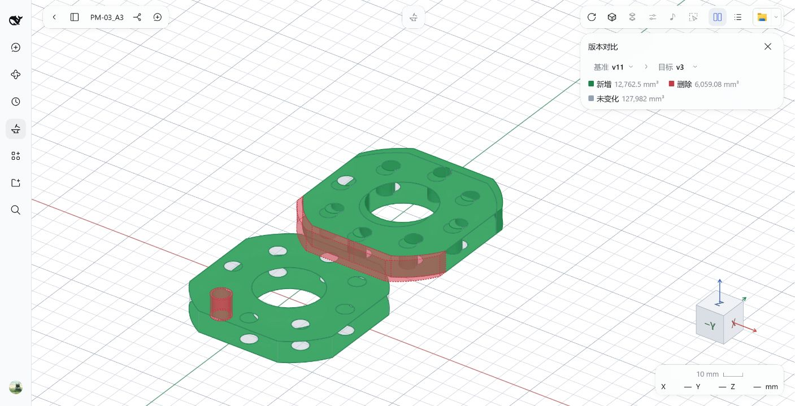

# MiniCAD for DeepSeek Harness

[简体中文](README.md) · [Install](#install) · [Usage](#make-your-first-part) · [Issues](https://github.com/merc-hecl/dsh-minicad/issues)

**Describe a part. Review it in 3D.**

Give the DSH agent dimensions or a reference drawing. It builds, revises and exports the model; you inspect the result and decide what changes next.

**AI coding disclosure:** 100% of this project's code was written by AI.


*Workbench overview: inspect independent parts and request changes on the same canvas.*

## What you can do

- **Model through conversation** — Create and revise exact solids from natural language or reference drawings, including independent parts and part or face colors.
- **Adjust parameters** — The agent provides numeric, choice and toggle controls for the model and requirements. Apply changes and dimensional checks directly; success saves a revision, and failure preserves the saved model.
- **Inspect and measure** — Solid, wireframe and transparent display, part visibility, sections and exploded views. Measure faces, edges and distances, reference selected geometry in requests, and check part clearance or interference.
- **Review revisions and processes** — Branch, switch and restore in the version tree, review modeling steps and geometry differences, and export design replays as WebM or GIF.
- **Manage designs and conversations** — Share a design across conversations and read their history; save an independent copy or generate model variants.
- **Deliver models** — Import SMP, SMB or STEP, export whole models or individual parts as STEP/STL, save a project ZIP, or open the current model in FreeCAD.
- **Play the part instrument** — Click the model to synthesize geometry-dependent strikes, record a performance and export MIDI.

| Parameter controls | Geometry measurements |
| --- | --- |
|  |  |
| Adjust plate thickness, hole diameters, part spacing and color. | Select geometry, inspect measurements and reference it in a request. |

| Revision branches | Geometry comparison |
| --- | --- |
|  |  |
| Browse branches, preview revisions and restore earlier models. | Green shows added volume; red shows removed volume. |

## Install

Targets **DSH 0.2.2-rc.1**. Uses your existing DSH model configuration; no separate API key.

**Desktop**

1. In DSH, open **Plugins → Add plugin**.
2. Enter `dsh-minicad`, click **Install** and enable it.
3. Restart if prompted, then open **MiniCAD** from the sidebar.

[Latest release (offline package and release notes)](https://github.com/merc-hecl/dsh-minicad/releases/latest)

For offline installation, fully extract the release package, keep its `node_modules`, and enter `link:/absolute/path/to/package` in **Add plugin**, such as `link:C:/MiniCAD/package` on Windows. Prebuilt packages need no dependency installation or build.

**Web** (Node.js 22.19+ and pnpm)

If pnpm is missing, run `npm install -g pnpm` first. Install from npm, then restart DSH:

```sh
npx @deepseek-ai/dsh@0.2.2-rc.1 plugin --profile web add dsh-minicad -w
```

For an offline package, replace `dsh-minicad` with `link:/absolute/path/to/package`. With a global dsh installation, `dsh` can replace `npx @deepseek-ai/dsh@0.2.2-rc.1`.

**Update and uninstall**

For a Desktop npm installation, uninstall through **Plugins** and reinstall by package name. For offline packages, extract to a new directory and switch the plugin path. On Web, replace `add` in the installation command with `update` or `remove`. Restart DSH afterward; uninstalling the plugin does not delete design files.

## Make your first part

1. **Pick a folder** — Open or create a design in MiniCAD.
2. **Describe it** — Specify dimensions and features, or attach a drawing.
3. **Review it** — Measure, request changes and compare versions. Ask the agent to export when ready.

> Make an 80 × 50 × 6 mm base plate with a 5 mm through hole at each corner. Each hole center is 8 mm from both adjacent edges.

Double-click the canvas to open the composer. After saving a model, use **Adjust parameters** in the toolbar to apply controls supplied by the agent; it is disabled when no suitable controls are available. Reading PDF drawings depends on available PDF tools and an image-capable model in DSH.

## FreeCAD

Open the current model from the native navigation menu at the top right. MiniCAD detects installed FreeCAD applications automatically. If detection fails, set an absolute executable path in DSH's `minicad` configuration:

```yaml
- id: minicad
  config:
    freecadExecutable: C:/Program Files/FreeCAD/bin/FreeCAD.exe
```

Leave it empty for automatic detection. When using a Web configuration patch, preserve any other settings on that row. Restart DSH after changing it. External CAD edits are not written back automatically; ask the agent to import the modified file to keep them.

## Design files and boundaries

- Each design has its own folder. Its conversations share models and history while keeping separate chat contexts; **Save as** creates an independent copy.
- Back up models and history by copying the entire design folder, including `.smp`, `.state.json` and hidden directories. DSH stores chat history separately. **Remove** only closes the catalog entry, preserving files and conversations.
- Do not let multiple DSH processes write to the same MiniCAD data directory.

Assembly constraints and CAM are outside the current scope. Valid geometry and dimensional checks do not establish structural strength or manufacturability. Design code runs with your user permissions. Only run code from trusted sources.

If the entry is missing, check the plugin profile and enabled state, then restart. If the model is invisible, check graphics acceleration/WebGL and whether a model was successfully saved.

[Development, packaging and publishing](AGENTS.md#开发与打包)

[MIT](LICENSE) · [Third-party notices](NOTICE.md)
