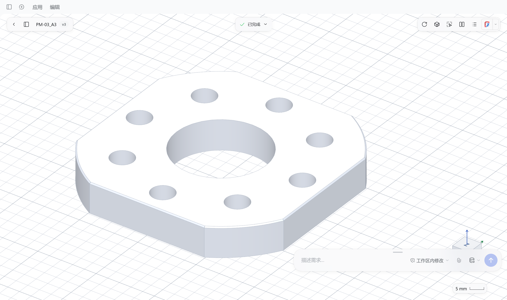
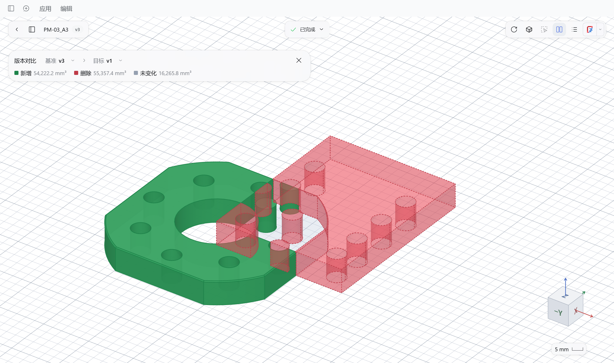

# MiniCAD for DeepSeek Harness

[简体中文](README.md) · [Install](#install) · [User guide](docs/guide.en.md) · [Issues](https://github.com/merc-hecl/dsh-minicad/issues)

**Describe a part. Review it in 3D.**

Give the DSH agent dimensions or a reference drawing. It builds, revises and exports the model; you inspect the result and decide what changes next.

**AI coding disclosure:** 100% of this project's code was written by AI.



## What you can do

- **Build and revise** — Parametric parts, independent multipart models, parameter variants and PDF drawing references.
- **Measure and reference** — Show, hide or isolate parts; select faces or edges to measure or request a precise change.
- **Compare and restore** — Switch revisions in the version tree, review modeling steps and compare geometry.
- **Keep designing** — Share one design across conversations, or save an independent copy.
- **Deliver** — Export whole models or individual parts as STEP/STL, save a project ZIP, or open the model in FreeCAD.



## Install

Targets **DSH 0.2.2-rc.1**. Uses your existing DSH model configuration; no separate API key.

**Desktop**

1. In DSH, open **Plugins → Add plugin**.
2. Enter `dsh-minicad`, click **Install** and enable it.
3. Restart if prompted, then open **MiniCAD** from the sidebar.

[Latest release (offline package and release notes)](https://github.com/merc-hecl/dsh-minicad/releases/latest)

**Web** (Node.js 22.19+ and [pnpm](docs/guide.en.md#web-installation))

Install from npm, then restart DSH:

```sh
npx @deepseek-ai/dsh@0.2.2-rc.1 plugin --profile web add dsh-minicad -w
```

## Make your first part

1. **Pick a folder** — Open or create a design in MiniCAD.
2. **Describe it** — Specify dimensions and features, or attach a drawing.
3. **Review it** — Measure, request changes and compare versions. Ask the agent to export when ready.

> Make an 80 × 50 × 6 mm base plate with a 5 mm through hole at each corner. Each hole center is 8 mm from both adjacent edges.

Supports single parts and multiple solids; assembly constraints and CAM are outside the current scope. Design code runs with your user permissions. Only run code from trusted sources.

[Usage and troubleshooting](docs/guide.en.md) · [Modeling API](docs/modeling-api.en.md) · [Development and packaging](docs/guide.en.md#run-from-source)

[MIT](LICENSE) · [Third-party notices](NOTICE.md)
