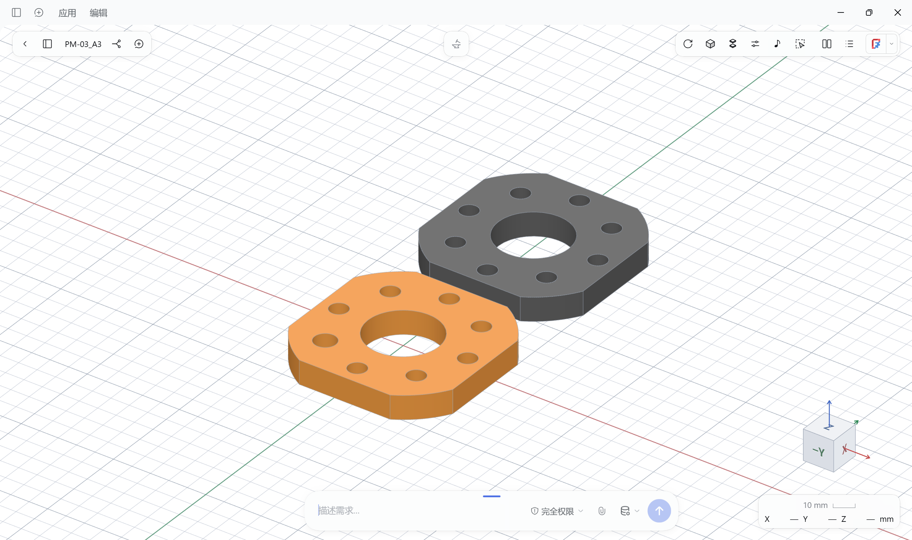
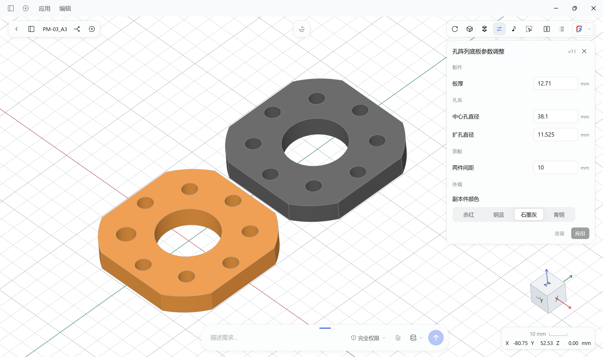
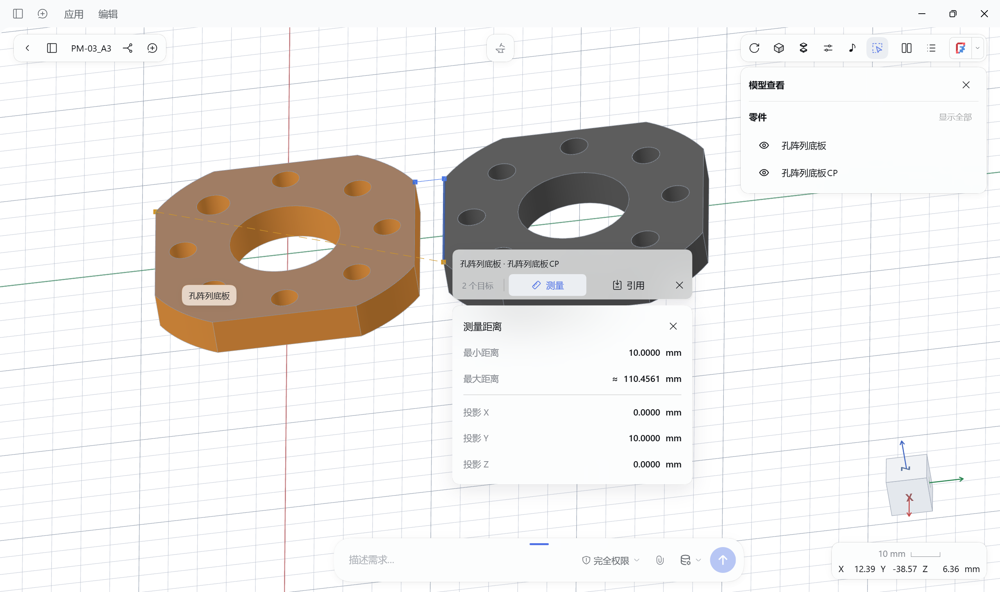
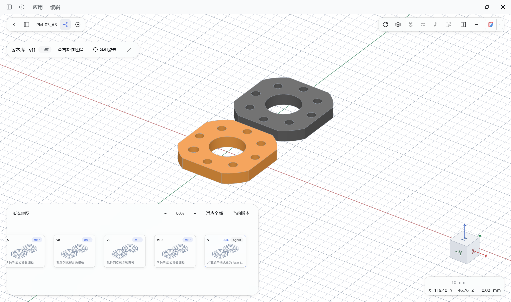
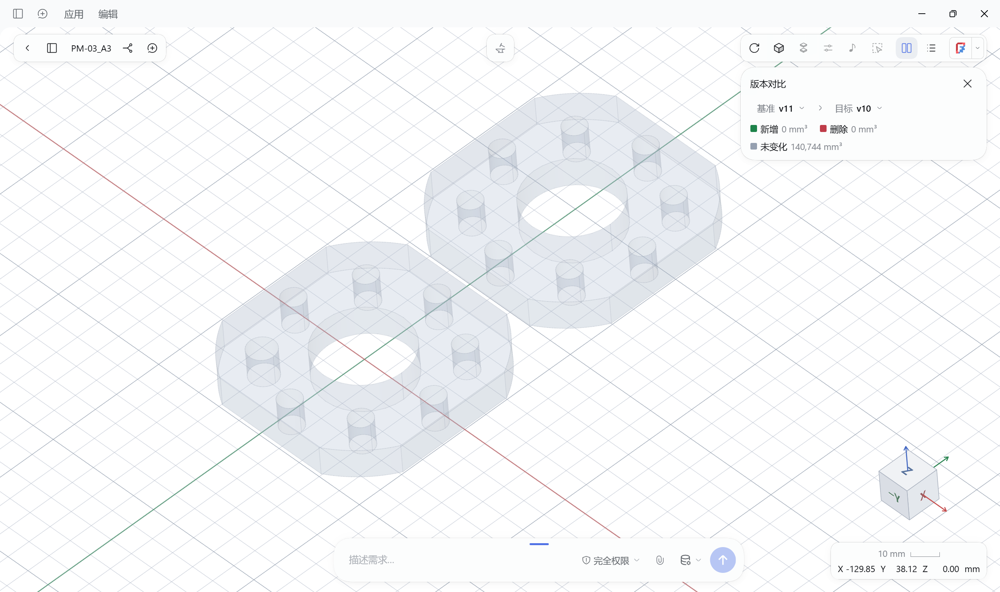

# MiniCAD for DeepSeek Harness

[English](README.en.md) · [安装](#安装) · [使用](#开始做一个零件) · [反馈](https://github.com/merc-hecl/dsh-minicad/issues)

**用自然语言做 CAD，在三维画布里核验结果。**

描述零件或提供参考图纸，让 DSH agent 建模、改尺寸、导出文件。你负责提出要求、查看模型和确认结果。

**AI 编写声明：** 本项目代码 100% 由 AI 编写。



*工作台总览：在同一画布中查看多零件模型并提出修改需求。*

## 能做什么

- **对话建模** — 根据自然语言或参考图纸创建、修改精确实体，支持独立多零件模型及工件、面的着色。
- **参数调整** — agent 按模型和需求生成数值、选项和开关控件；直接应用调整与尺寸检查，成功后保存版本，失败保留原模型。
- **查看与核验** — 实体、线框、透明显示，零件显隐、剖切和爆炸视图；测量面、边和目标间距离，将选中几何引用给 agent，检查零件间隙与干涉。
- **版本与过程** — 在树状版本库中分支、切换和恢复，回看制作过程与几何差异；回放设计演变并导出 WebM/GIF。
- **设计与会话** — 多个会话共享一个设计，查看会话记录；另存为独立方案，或生成多个模型规格。
- **模型交付** — 导入 SMP、SMB、STEP，整组或按零件导出 STEP、STL，导出项目 ZIP，或将当前模型交给 FreeCAD 打开。
- **零件乐器** — 点击模型发出随几何变化的敲击声，录制演奏并导出 MIDI。

| 参数调整 | 几何测量 |
| --- | --- |
|  |  |
| 调整板厚、孔径、零件间距与颜色。 | 选中几何，查看测量结果并引用给 agent。 |

| 版本分支 | 几何对比 |
| --- | --- |
|  |  |
| 查看版本分支，预览并恢复历史模型。 | 绿色为新增体积，红色为删除体积。 |

## 安装

适配 **DSH 0.2.2-rc.1**。使用 DSH 中已配置的模型，无需另配 API Key。

**桌面版**

1. 在 DSH 中打开「插件」→「添加插件」。
2. 输入 `dsh-minicad`，点击「安装」并启用。
3. 按提示重启，从侧栏打开 **MiniCAD**。

[最新发布：离线安装包与发布说明](https://github.com/merc-hecl/dsh-minicad/releases/latest)

离线安装：完整解压发布包并保留其中的 `node_modules`，在「添加插件」中输入 `link:解压后的 package 目录`，例如 `link:C:/MiniCAD/package`。预构建包无需另外安装依赖或构建。

**Web**（Node.js 22.19+、pnpm）

尚未安装 pnpm 时，先运行 `npm install -g pnpm`。从 npm 安装，完成后重启 DSH：

```sh
npx @deepseek-ai/dsh@0.2.2-rc.1 plugin --profile web add dsh-minicad -w
```

安装离线包时，将 `dsh-minicad` 换成 `link:解压后的 package 目录`；已有全局 dsh 时，可用 `dsh` 替代 `npx @deepseek-ai/dsh@0.2.2-rc.1`。

**更新与卸载**

桌面版 npm 安装先在「插件」页卸载，再按包名重新安装；离线包解压到新目录后切换插件路径。Web 将上方安装命令中的 `add` 换成 `update` 或 `remove`。操作后重启 DSH；卸载插件不删除设计文件。

## 开始做一个零件

1. **选文件夹** — 在 MiniCAD 中打开或新建设计。
2. **说需求** — 描述尺寸和特征，或添加图纸。
3. **看结果** — 测量、引用修改、对比版本；满意后让 agent 导出。

> 做一个 80 × 50 × 6 mm 的底板，四角各加一个直径 5 mm 的通孔，孔中心距相邻边均为 8 mm。

双击画布打开输入框。模型保存后，可用工具栏的「参数调整」应用 agent 提供的调整项；没有合适调整项时入口置灰。PDF 图纸读取取决于 DSH 中可用的 PDF 工具与支持图片的模型。

## FreeCAD

从右上角原生导航菜单打开当前模型。插件自动检测已安装的 FreeCAD；未检测到时，在 DSH 的 `minicad` 配置中设置可执行文件的绝对路径：

```yaml
- id: minicad
  config:
    freecadExecutable: C:/Program Files/FreeCAD/bin/FreeCAD.exe
```

留空使用自动检测。Web 使用补丁配置时，保留该行已有的其他配置；修改后重启 DSH。外部 CAD 修改不会自动写回，需要保留时让 agent 导入修改后的文件。

## 设计文件与边界

- 一个设计对应一个文件夹，会话共享模型与历史，各自保留独立聊天上下文；「另存为」创建独立方案。
- 备份模型与历史时复制整个设计文件夹，包括 `.smp`、`.state.json` 和隐藏目录；聊天记录由 DSH 单独保存。「移除」只关闭列表登记，保留文件和会话。
- 不要让多个 DSH 进程同时写入同一 MiniCAD 数据目录。

暂不包含装配约束和 CAM；几何有效与尺寸检查不等于结构强度或加工可行性验证。建模源码以当前用户权限执行，仅运行可信来源的设计代码。

入口未出现时，确认插件所在 profile、启用状态并重启；模型无法显示时，检查图形加速/WebGL，以及是否已成功保存模型。

[开发、打包与发布](AGENTS.md#开发与打包)

[MIT](LICENSE) · [第三方声明](NOTICE.md)
